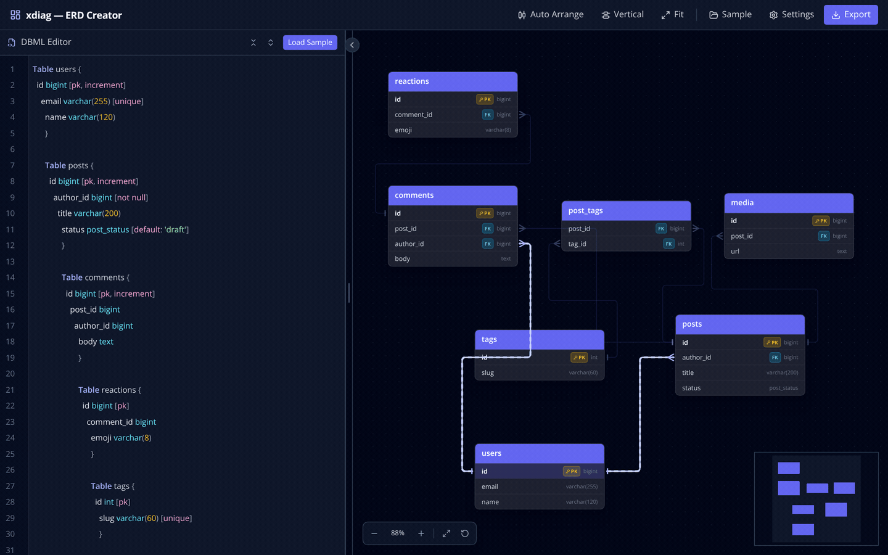

# xdiag

**A fast, local-first ERD creator for DBML.** Type or paste a [DBML](https://dbml.dbdiagram.io) schema, get a live entity-relationship diagram you can drag, style and export — no account, no server round-trips, nothing leaves your browser.



## Features

- **Live DBML editing** — CodeMirror 6 with DBML syntax highlighting, line numbers, bracket-aware folding for `Table`/`Enum`/`TableGroup` blocks, fold-all/unfold-all, and error markers with line + column.
- **Resilient parsing** — the diagram keeps the last good schema while you type; malformed input never blanks the canvas.
- **Auto-layout** — [dagre](https://github.com/dagrejs/dagre) ranks tables horizontally or vertically, with compound `TableGroup` boundaries rendered as dashed containers.
- **Crow's-foot relations** — cardinality is carried by the line ends only (bar = one, fan = many) at a constant on-screen size, so markers stay legible at any zoom.
- **Nearest-side routing** — every relation re-picks the closest edge of both tables as you drag, so endpoints never point into empty space.
- **Hover focus** — hovering a field highlights its relation and animates flow from the referencing side; unrelated edges dim.
- **Navigation** — zoom in/out, zoom-to-fit (`f`), reset to 100 % (`0`), minimap, and a drag-resizable, collapsible editor pane.
- **Theming** — five palettes (Indigo Slate, Ocean, Forest, Rose, Amber) plus accent/background/relation colour overrides, grid and minimap toggles, flow animation speed and thickness. Everything is driven by `--xd-*` CSS variables and persisted in `localStorage`.
- **Export** — DBML, PostgreSQL DDL, MySQL DDL, and JSON, with copy-to-clipboard and file download.

## Quick start

```bash
pnpm install
pnpm dev        # http://localhost:5173
```

Click **Sample** in the toolbar for a 22-table e-commerce schema covering 1:1, 1:N and N:M relations.

### Scripts

| Command | What it does |
|---|---|
| `pnpm dev` | Vite dev server with HMR |
| `pnpm build` | Type-check (`tsc -b`) then build to `dist/` |
| `pnpm preview` | Serve the production build locally |
| `pnpm test` | Vitest suite (parser, layout/routing, SQL export, settings) |
| `pnpm coverage` | Same suite with v8 coverage |
| `pnpm lint` | oxlint |

## Docker

```bash
docker build -t xdiag .
docker run --rm -p 8088:8080 xdiag
# → http://localhost:8088
```

The runtime image is nginx-alpine serving static assets as the unprivileged `nginx` user on port 8080, with a health check, `server_tokens off`, long-lived immutable caching for hashed assets, and a strict CSP (`default-src 'self'`).

## DBML in, ERD out

```dbml
Enum post_status {
  draft
  published
}

Table users {
  id     bigint       [pk, increment]
  email  varchar(255) [unique, not null]
  name   varchar(120)
}

Table posts {
  id        bigint      [pk, increment]
  author_id bigint      [not null]
  title     varchar(200)
  status    post_status [default: 'draft']
}

Ref: posts.author_id > users.id [delete: cascade]
```

Inline refs (`user_id bigint [ref: > users.id]`), standalone `Ref` lines, `TableGroup` blocks, schema-qualified names (`auth.users`), enums, composite primary keys from `indexes {}`, and field/table notes are all supported.

Generated PostgreSQL for the FK above:

```sql
ALTER TABLE "posts"
  ADD CONSTRAINT "fk_posts_author_id"
  FOREIGN KEY ("author_id")
  REFERENCES "users" ("id")
  ON DELETE CASCADE;
```

## Project layout

```
src/
  engine/          dbmlParser.ts · layout.ts (dagre + nearest-side routing) · sqlExporter.ts
  components/
    canvas/        ERDCanvas · TableNode · GroupNode · RelationEdge · ZoomControls
    editor/        EditorPanel (CodeMirror 6, DBML folds + highlight)
    toolbar/       Toolbar
    settings/      SettingsModal
    export/        ExportModal
  theme.ts         palettes, CSS-variable tokens, localStorage persistence
  types/schema.ts  normalized schema model
deploy/nginx.conf  unprivileged static server config
```

The engine is pure TypeScript with no React dependency, which is why all 52 unit tests target it directly; UI behaviour is verified in a real browser.

## Security

Dependencies and the built image are scanned with Trivy in CI (see [`SECURITY.md`](SECURITY.md) for the current baseline and how to reproduce it).

## Contributing

Issues and pull requests are welcome. Run `pnpm lint && pnpm test && pnpm build` before pushing; keep the engine free of React imports and add a test alongside any parser, layout or exporter change.

## License

[MIT](LICENSE) © Resa Aqrobby
